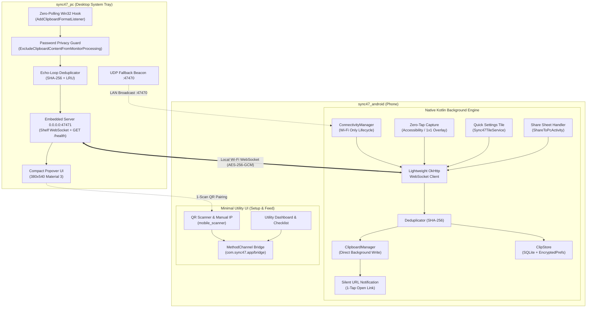

# Sync47: Cross-Platform Local Wi-Fi Clipboard Sync

**Sync47** is an ultra-lightweight, peer-to-peer local Wi-Fi clipboard synchronization suite. It synchronizes text and URLs between Windows/Linux PCs and Android phones seamlessly without cloud servers, third-party accounts, or subscriptions.

---

## Architecture Overview



---

## Key Highlights & Optimization Mandates

### 1. Zero-Polling PC Clipboard Engine (`sync47_pc`)
- **0% Idle CPU:** Utilizes Win32 native `AddClipboardFormatListener` attached to a hidden `HWND_MESSAGE` window. No polling (`Timer.periodic`) is ever used.
- **Password Manager Privacy:** Before processing any clip, checks registered formats for `ExcludeClipboardContentFromMonitorProcessing` and `CanIncludeInClipboardHistory`. Clips from Bitwarden, 1Password, KeePass, or Windows Hello are immediately dropped.
- **Multi-Interface IP Discovery:** Filters out virtual adapters (`vEthernet`, `WSL`, `Hyper-V`, `VirtualBox`, `VMware`, `Tailscale`) and prioritizes active LAN/Wi-Fi IPv4 addresses. Includes an interface selection dropdown on the pairing dialog.
- **Built-in Diagnostics:** Exposes plain HTTP `GET /health` with CORS support for instantaneous reachability and latency testing.
- **Silent Tray Boot:** Supports `--minimized` launch argument. Left-click opens a compact `380 × 540 px` popover window; right-click opens the tray context menu.

### 2. Ultra-Low-Battery Android Engine (`sync47_android`)
- **Single-Process State Reliability:** Service and Flutter UI share application state and `EncryptedSharedPreferences` directly without cross-process IPC failure.
- **Cleartext LAN WebSockets:** Configured with `network_security_config.xml` permitting cleartext `ws://` traffic on private IP subnets (`192.168.0.0/16`, `10.0.0.0/8`, `172.16.0.0/12`).
- **Wi-Fi-Only Lifecycle:** Controlled via `ConnectivityManager.NetworkCallback`. When Wi-Fi disconnects, the socket shuts down and the service goes completely dormant.
- **True Zero-Tap Two-Way Sync (Android 10+ Compliant):**
  - **PC $\rightarrow$ Phone:** Direct background clipboard write via `ClipboardManager.setPrimaryClip()`.
  - **Phone $\rightarrow$ PC (Zero-Tap Automatic):** `Sync47AccessibilityService` pairs with an invisible `1 × 1` pixel focus overlay (`ClipboardOverlayHelper.kt`) to bypass Android 10+ background clipboard restrictions with zero UI flicker.
  - **ADB Logcat Watcher (Alternative):** Power-user method using `android.permission.READ_LOGS` to watch for copy events.
  - **Quick Settings Tile:** Tap from notification shade to capture and push clipboard instantly.
  - **Share Sheet:** Select text anywhere $\rightarrow$ Share $\rightarrow$ Sync47.
  - **1-Tap URL Launch:** Received URLs generate a dismissible, silent notification with a direct "Open Link" button.

### 3. End-to-End Encryption Parity
- **Algorithm:** AES-256-GCM with 128-bit authentication tag.
- **Wire Layout:** `Base64( 12-byte random IV || ciphertext || 16-byte GCM tag )`.
- Tested byte-for-byte between Dart `sync47_core` and Kotlin `javax.crypto.Cipher`.

---

## Monorepo Structure

```text
sync47/
├── README.md
├── packages/
│   └── sync47_core/          # Shared Dart models, AES-256-GCM, deduplication
├── apps/
│   ├── sync47_pc/            # Desktop system tray popover app (Windows / Linux)
│   └── sync47_android/       # Flutter UI + pure native Kotlin engine
└── scripts/
    └── build_all.ps1         # Automated release build script
```

---

## Windows Defender Firewall Configuration

To ensure your Android phone can communicate with `sync47_pc` on your local Wi-Fi network, run the following PowerShell command as Administrator:

```powershell
New-NetFirewallRule -DisplayName "Sync47 TCP" -Direction Inbound -Protocol TCP -LocalPort 47471 -Action Allow -Profile Any
New-NetFirewallRule -DisplayName "Sync47 UDP" -Direction Inbound -Protocol UDP -LocalPort 47470 -Action Allow -Profile Any
```

---

## Quick Start & Build Instructions

### 1. Build Everything (Release)
Run the automated build script:
```powershell
.\scripts\build_all.ps1
```

### 2. Run PC Desktop App
Pre-compiled executable:
`apps/sync47_pc/build/windows/x64/runner/Release/sync47_pc.exe`

Or run via Flutter:
```powershell
cd apps/sync47_pc
flutter run -d windows
```

### 3. Install Android APK
Pre-compiled release APK:
`apps/sync47_android/build/app/outputs/flutter-apk/app-release.apk`

Install via ADB:
```powershell
adb install -r apps/sync47_android/build/app/outputs/flutter-apk/app-release.apk
```

### 4. 1-Scan Pairing
1. On your PC, click **Pair Phone** to display the QR code (and check that the selected network interface matches your Wi-Fi router subnet).
2. On your Android device, open Sync47 and tap **Scan PC QR Code** (or tap **Enter PC IP Manually** if camera access is unavailable).
3. The phone connects to `ws://<ip>:47471/ws` and tests the HTTP `/health` endpoint.
4. On the Android dashboard, complete the **Zero-Tap Auto-Sync Checklist** (Enable Accessibility Service & Display Over Other Apps) for seamless hands-free background sync!
